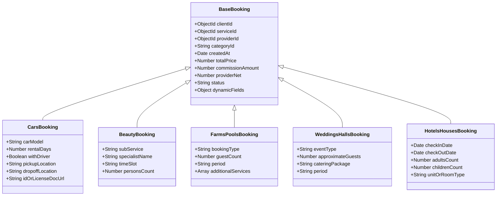

# وثيقة التحليل الفني الشامل وتصميم النظام (System Architecture & Deep Analysis)
## مشروع منصة وتطبيق "احجزلي Dz" (Ihjizli Dz Platform)

---

## 1. نظرة عامة على النظام (Executive Summary)

**"احجزلي Dz"** هي منصة رقمية جزائرية رائدة ومتعددة الأطراف (Multi-Vendor Marketplace & Booking Platform) مصممة لتسهيل حجز وإدارة مختلف الخدمات الترفيهية، السياحية، والخدماتية في 58 ولاية جزائرية. المنظومة تتكون من أربعة أركان رئيسية:
1. **الخادم وقاعدة البيانات (`/backend`):** RESTful API متطور مبني بتقنيات Node.js وExpress وMongoDB، يدعم الحجوزات الديناميكية (Dynamic Booking Schemas)، التوثيق بنظام JWT، إدارة الصلاحيات RBAC، دورة حياة اشتراكات المزودين، وحساب العمولات المالية بدقة بالدينار الجزائري (DZD).
2. **لوحة تحكم الإدارة العليا (`/admin-dashboard`):** لوحة تحكم ويب عصرية بالكامل (React + Tailwind CSS + RTL) توفر رؤية شاملة للمؤشرات التشغيلية والمالية، وإدارة الخدمات، والتصنيفات، والتحكم في تسعير الاشتراكات وتفعيل المزودين.
3. **لوحة تحكم مزود الخدمة (`/provider-dashboard`):** لوحة ويب مخصصة لشركاء الخدمة لإدارة عروضهم، استقبال الحجوزات الخاصة بكل قسم مع الحقول الديناميكية، تأكيد/رفض الطلبات، متابعة الأرباح والعمولات، ونظام حماية الاشتراك الإجباري.
4. **تطبيق الموبايل (`/mobile-app`):** تطبيق Flutter بهندسة MVC متكاملة، يربط المستخدم بالخدمات الفعلية، مع نماذج حجز ديناميكية تتغير كلياً حسب طبيعة كل نشاط من الأنشطة الثمانية.

---

## 2. التحليل المعمق للأقسام الثمانية ونماذج الحجز الديناميكية (Dynamic Booking Schema)

تختلف متطلبات الحجز باختلاف طبيعة النشاط، لذا لا يمكن الاعتماد على نموذج حجز تقليدي (تاريخ ووقت فقط). تم تصميم **مخطط حجز ديناميكي (Dynamic Booking Schema)** مخصص لكل قسم:

### تفصيل الأقسام الثمانية:

### القسم 1: كراء السيارات (Cars)
* **المعرف:** `cars`
* **طبيعة النشاط:** تأجير مركبات وسيارات سياحية وفارهة وسيارات أعراس.
* **الحقول الديناميكية المطلوبة (`dynamicFields`):**
  1. `carModel` (نص): موديل السيارة المرغوبة أو فئتها (مثال: سياحية مدمجة، دفع رباعي، سيارة فاخرة للأعراس).
  2. `rentalDays` (رقم صحيح): عدد أيام الإيجار (الحد الأدنى: 1 يوم).
  3. `withDriver` (منطقي boolean): خيار طلب سائق خاص أو استئجار بدون سائق.
  4. `pickupLocation` (نص): مكان استلام المركبة (المطار، مقر الوكالة، أو توصيل إلى عنوان مخصص).
  5. `dropoffLocation` (نص): مكان تسليم المركبة.
  6. `licenseDocument` (رابط نصي / ملف): صورة رخصة القيادة أو بطاقة التعريف الوطنية للمستأجر (إلزامي في حال كان الحجز بدون سائق).
* **طريقة احتساب السعر:**
  $$\text{Total} = (\text{سعر اليوم} \times \text{عدد الأيام}) + (\text{رسوم السائق اليومية إن وجدت} \times \text{عدد الأيام})$$

---

### القسم 2: التجميل والحلاقة (Beauty & Spa)
* **المعرف:** `beauty`
* **طبيعة النشاط:** صالونات الحلاقة الرجالية، صالونات التجميل النسائية، ومراكز العناية والسبا وتجهيز العرائس.
* **الحقول الديناميكية المطلوبة (`dynamicFields`):**
  1. `subService` (اختيار متعدد / نص): الخدمة الفرعية المختارة (مثال: تجهيز عرائس كامل، قص وتسريح شعر، تنظيف بشرة عميق، مساج واستجمام).
  2. `specialistName` (نص اختياري): اسم خبير/خبيرة التجميل المفضل(ة) أو الحجز مع أي متاح.
  3. `timeSlot` (ساعة دقيقة): وقت الموعد الدقيق المحدد بالساعة والدقيقة (مثال: 10:30 صباحاً، 02:00 زوالاً).
  4. `personsCount` (رقم صحيح): عدد الأشخاص أو المرافقين (1 - 5 أفراد).
* **طريقة احتساب السعر:**
  $$\text{Total} = \text{سعر الباقة الأساسية} + \text{أسعار الخدمات الفرعية الإضافية} \times \text{عدد الأشخاص}$$

---

### القسم 3 و 5: المزارع (Farms) والمسابح (Pools)
* **المعرف:** `farms` & `pools`
* **طبيعة النشاط:** استئجار مزارع ريفية، مسابح خاصة مغطاة ومفتوحة، وجلسات استجمام يومية أو ليلية.
* **الحقول الديناميكية المطلوبة (`dynamicFields`):**
  1. `bookingType` (قائمة اختيار): نوع الحجز: عائلي (Families Only) أو شبابي (Youth/Friends).
  2. `guestCount` (رقم صحيح): عدد الضيوف الإجمالي (للتأكد من عدم تجاوز الطاقة الاستيعابية).
  3. `period` (قائمة اختيار): الفترة المختارة:
     * فترة صباحية (من 09:00 إلى 17:00)
     * فترة مسائية (من 18:00 إلى 23:30)
     * يوم كامل (24 ساعة مع المبيت)
  4. `additionalServices` (مصفوفة نصوص): خيارات إضافية:
     * توفير عتاد الشواء والفحم
     * تجهيز جلسة مسبح وطاولات ضيافة
     * نظام صوتي وإضاءة ليلية
* **طريقة احتساب السعر:**
  $$\text{Total} = \text{سعر الفترة المختارة} + \text{رسوم الخدمات الإضافية المحددة}$$

---

### القسم 4 و 7: قاعات الأفراح (Wedding Halls) والمزارع والقاعات (Farms & Halls)
* **المعرف:** `weddings` & `farms_halls`
* **طبيعة النشاط:** تنظيم حفلات الزفاف، الخطوبة، المآدب الرسمية، والمناسبات الكبرى.
* **الحقول الديناميكية المطلوبة (`dynamicFields`):**
  1. `eventType` (قائمة اختيار): نوع المناسبة (عرس / زفاف، خطوبة، حفل نجاح وتخرج، مأدبة عشاء، مؤتمر عمل).
  2. `approximateGuests` (رقم صحيح): عدد المدعوين التقريبي (مثال: 100، 250، 500 مدعو).
  3. `cateringPackage` (قائمة اختيار): باقة الضيافة المختارة:
     * القاعة فقط بدون إطعام
     * باقة الشاي والحلويات التقليدية والمشروبات
     * باقة العشاء الكاملة (كسكسي، طاجين، بوراك، سلطات، فواكه ومشروبات)
  4. `period` (قائمة اختيار): فترة الحفل:
     * فترة غداء (12:00 إلى 17:00)
     * فترة عشاء (19:00 إلى 01:00 فجراً)
* **طريقة احتساب السعر:**
  $$\text{Total} = \text{سعر حجز القاعة} + (\text{سعر باقة الضيافة للشخص} \times \text{عدد المدعوين})$$

---

### القسم 6 و 8: فنادق (Hotels) وكراء المنازل والشقق (Houses)
* **المعرف:** `hotels` & `houses`
* **طبيعة النشاط:** إقامة فندقية وسياحية، شقق مفروشة، وشاليهات لقضاء العطلات والإقامات القصيرة والطويلة.
* **الحقول الديناميكية المطلوبة (`dynamicFields`):**
  1. `checkInDate` (تاريخ): تاريخ ووقت الدخول (Check-in).
  2. `checkOutDate` (تاريخ): تاريخ الخروج (Check-out).
  3. `adultsCount` (رقم صحيح): عدد النزلاء البالغين (1 فما فوق).
  4. `childrenCount` (رقم صحيح): عدد الأطفال النزلاء.
  5. `unitOrRoomType` (قائمة اختيار): نوع الإقامة / الغرفة (غرفة فردية، غرفة مزدوجة، جناح عائلي، شقة F2، فيلا F4).
* **طريقة احتساب السعر:**
  $$\text{عدد الليالي} = \text{CheckOut} - \text{CheckIn}$$
  $$\text{Total} = \text{سعر الليلة} \times \text{عدد الليالي}$$

---

## 3. مصفوفة الصلاحيات وأدوار النظام (RBAC Matrix)

| الوظيفة / الإجراء | العميل (Client) | مزود الخدمة (Provider) | الإدارة العليا (Admin) | الزائر (Guest) |
| :--- | :---: | :---: | :---: | :---: |
| تصفح الخدمات والتصنيفات والبحث | ✅ | ✅ | ✅ | ✅ |
| تسجيل الدخول / إنشاء حساب | ✅ | ✅ | ✅ | ❌ |
| إنشاء حجز جديد بحقول ديناميكية | ✅ | ❌ | ❌ | ❌ |
| عرض سجل حجوزاته وإلغاء حجز معلق | ✅ | ❌ | ❌ | ❌ |
| إضافة وتعديل وحذف خدماته الخاصة | ❌ | ✅ (إذا الاشتراك نشط) | ✅ | ❌ |
| استقبال وقبول ورفض الحجوزات | ❌ | ✅ (إذا الاشتراك نشط) | ❌ | ❌ |
| تجديد الاشتراك ورفع إشعار الدفع | ❌ | ✅ | ❌ | ❌ |
| تفعيل أو تجميد اشتراكات المزودين | ❌ | ❌ | ✅ | ❌ |
| التحكم في أسعار الاشتراكات والعمولة | ❌ | ❌ | ✅ | ❌ |
| إدارة التصنيفات وتعديل الحقول الديناميكية | ❌ | ❌ | ✅ | ❌ |
| سحب تقارير الأرباح والمستحقات | ❌ | ✅ (أرباحه الخاصة) | ✅ (أرباح المنصة بالكامل) | ❌ |

---

## 4. نموذج الاشتراك المالي للمزودين (Subscription Lifecycle & Financial Rules)

### دورة حياة الاشتراك:
1. **التسجيل الأولي:** ينشئ المزود حسابه، ويدخل في حالة `pending_subscription`.
2. **التفعيل الإداري:** يقوم المزود بدفع المقابل (عبر بريدي موب BaridiMob أو CCP)، وتدخل الإدارة اللوحة لتفعيل الاشتراك مع تحديد تاريخ البداية والانتهاء (شهري أو سنوي).
3. **الاشتراك النشط (`active`):** تتاح للمزود كافة مزايا اللوحة (إضافة وتعديل الخدمات، استقبال الحجوزات الجديدة، تأكيد الطلبات، سحب التقارير).
4. **انتهاء الاشتراك (`expired`):**
   * **حاجز الحماية البرمجي (Subscription Guard):**
     * لا يمكن للمزود قبول أي حجز جديد؛ تظهر له شاشة حاجبة (Modal/Overlay) تنبهه بضرورة التجديد فوراً.
     * إيقاف ظهور خدماته مؤقتاً في نتائج بحث التطبيق أو تمييزها بأنها غير متاحة للحجز حالياً.
     * يمكنه فقط استعراض الأرشيف المالي وحجوزاته السابقة للتسوية المالية.

### النموذج المالي لاقتسام الأرباح (Platform Commission & Net Payouts):
* يحدد الأدمن نسبة عمولة المنصة في الإعدادات (مثلاً: 10%).
* عند إتمام حجز بقيمة 10,000 د.ج:
  * عمولة المنصة: $10,000 \times 10\% = 1,000 \text{ د.ج}$.
  * صافي مستحقات المزود: $10,000 - 1,000 = 9,000 \text{ د.ج}$.
* إيرادات المنصة الكلية تتكون من شقين:
  1. عوائد الاشتراكات الثابتة (شهرية / سنوية).
  2. عوائد عمولة الحجوزات الناجحة والمكتملة.

---

## 5. تتبع أزرار وشاشات تطبيق الموبايل (Screen & Button Traceability Matrix)

| الشاشة في التطبيق | العنصر التفاعلي / الزر | الوظيفة البرمجية السابقة (Mock) | الوظيفة البرمجية الجديدة (Live API) | نقطة النهاية (API Endpoint) |
| :--- | :--- | :--- | :--- | :--- |
| **الصفحة الرئيسية (Home)** | منتقي المدينة (City Picker) | يغير متغير محلي فقط | يفلتر جلب الخدمات والتصنيفات بحسب ولاية المستخدم | `GET /api/services?city={city}` |
| | شريط البحث الرئيسي | تصفية قائمة الذاكرة | بحث ديناميكي في قاعدة بيانات السيرفر | `GET /api/services?search={query}&city={city}` |
| | كروت التصنيفات الـ 8 | فتح صفحة CategoryView مع بيانات محلية | جلب تصنيفات حية من الخادم ثم الانتقال لقسم الخدمات | `GET /api/categories`, `GET /api/services?category={id}` |
| | زر "عرض الكل >" للتصنيفات | فتح قائمة محلية | جلب كل الخدمات والتصنيفات من الـ API | `GET /api/services` |
| | بانر "أعلن عن مشروعك" | إظهار SnackBar وهمي | فتح نموذج طلب ترقية لمزود خدمة أو الانتقال لإنشاء حساب مزود | `POST /api/auth/register-provider` |
| | قسم عروض وخصومات | تصفية قائمة محلية للخصومات | جلب العروض الترويجية الحية التي تحتوي `discountPercent > 0` | `GET /api/services?discounted=true` |
| **صفحة التصنيف (Category)** | حقل البحث الداخلي | فلترة محلية للنصوص | جلب الخدمات المطابقة داخل هذا التصنيف عبر الـ API | `GET /api/services?category={id}&search={q}` |
| | كرت الخدمة | الانتقال لصفحة تفاصيل الخدمة | الانتقال لصفحة التفاصيل مع تمرير المعرف وجلب أحدث البيانات | `GET /api/services/{id}` |
| **تفاصيل الخدمة (Details)** | زر المفضلة (Heart Icon) | إضافة في Set محلي | إرسال طلب إضافة/إزالة الخدمة من مفضلة العميل في السيرفر | `POST /api/favorites/toggle/{serviceId}` |
| | زر "احجز الآن" (Book Now) | فتح شاشة حجز عامة | فتح شاشة الحجز المخصصة مع توليد الحقول الديناميكية الخاصة بهذا القسم | نقل بيانات النموذج الديناميكي |
| **شاشة الحجز (Booking)** | محدد التاريخ والفترة | اختيار تاريخ عام فقط | حقول ديناميكية تختلف بحسب القسم (سيارات: أيام ورخصة؛ تجميل: باقة ومختص؛ فنادق: check-in/out) | التحقق من صحة المدخلات في الـ Client |
| | زر "تأكيد وإرسال الحجز" | إنشاء حجز وهمي في القائمة | إرسال الحجز الديناميكي الكامل للـ Backend مع حساب الأسعار وحفظه في MongoDB | `POST /api/bookings` |
| **سجل الحجوزات (History)** | تبويب الحجوزات الحالية والسابقة | قراءة List ثابتة | جلب حجوزات المستخدم الفعلية من قاعدة البيانات | `GET /api/bookings/my-bookings` |
| | زر "إلغاء الحجز" | تعديل الحالة في الذاكرة | إرسال طلب إلغاء الحجز للسيرفر وتحديث الحالة إلى `cancelled` | `PUT /api/bookings/{id}/cancel` |
| **شاشة المفضلة (Favorites)** | قائمة الخدمات المحفوظة | قراءة من الذاكرة المحلية | جلب قائمة الخدمات المفضلة المرتبطة بحساب المستخدم | `GET /api/favorites` |
| **شاشة الإشعارات (Notifications)** | قائمة التنبيهات | نصوص ثابتة | جلب الإشعارات الخاصة بالحجوزات وتأكيد المزود | `GET /api/notifications` |
| | زر "تحديد الكل كمقروء" | تعديل في الذاكرة | تحديث حالة الإشعارات في السيرفر إلى مقروءة | `PUT /api/notifications/mark-read` |
| **شاشة حسابي (Profile)** | بيانات المستخدم | نصوص ثابتة لأحمد بن علي | عرض اسم العميل الحقيقي، هاتفه، بريده، وولايته المسجلة | `GET /api/auth/me` |
| | زر "تسجيل الدخول / الخروج" | زر وهمي أحمر | تسجيل خروج ومسح التوكن، أو فتح شاشات الدخول والإنشاء | `POST /api/auth/logout` |
| | شاشات الدخول والإنشاء الجديدة | شاشات غير موجودة | شاشات أصيلة (Auth Views) تتيح الدخول وحفظ JWT Token | `POST /api/auth/login`, `POST /api/auth/register` |

---

## 6. تصميم واجهات برمجة التطبيقات (API Contract Endpoints)

| المسار (Path) | الطريقة (Method) | الصلاحية (Auth) | الوصف |
| :--- | :---: | :---: | :--- |
| `/api/auth/register` | POST | عام | إنشاء حساب جديد (عميل أو مزود خدمة) |
| `/api/auth/login` | POST | عام | تسجيل الدخول واستلام JWT Token |
| `/api/auth/me` | GET | مستخدم مسجل | جلب الملف الشخصي وصلاحيات المستخدم الحالي |
| `/api/auth/profile` | PUT | مستخدم مسجل | تحديث بيانات الملف الشخصي والولاية والهاتف |
| `/api/categories` | GET | عام | جلب التصنيفات الثمانية مع حقولها الديناميكية |
| `/api/categories` | POST / PUT / DELETE | أدمن | إدارة وتعديل الأقسام والحقول الديناميكية |
| `/api/services` | GET | عام | جلب الخدمات المعتمدة مع الفلترة بالقسم، الولاية، والبحث |
| `/api/services/:id` | GET | عام | جلب تفاصيل خدمة معينة ومميزاتها وتقييماتها |
| `/api/services` | POST | مزود / أدمن | إضافة خدمة جديدة (تخضع للموافقة إن كانت من مزود) |
| `/api/services/:id` | PUT / DELETE | مزود / أدمن | تعديل أو حذف خدمة يملكها المزود |
| `/api/services/:id/approval` | PATCH | أدمن | الموافقة على الخدمة أو رفضها |
| `/api/bookings` | POST | عميل مسجل | إنشاء حجز جديد مع التحقق من الحقول الديناميكية للقسم |
| `/api/bookings/my-bookings` | GET | عميل مسجل | جلب سجل حجوزات العميل الحالي |
| `/api/bookings/:id/cancel` | PUT | عميل مسجل | إلغاء حجز معلق من قبل العميل |
| `/api/bookings/provider-bookings` | GET | مزود خدمة | جلب الحجوزات الواردة لخدمات المزود الحالي |
| `/api/bookings/:id/status` | PATCH | مزود خدمة | تغيير حالة الحجز (`confirmed`, `rejected`, `completed`) |
| `/api/bookings/all` | GET | أدمن | استعراض كافة الحجوزات عبر كل الولايات والمزودين |
| `/api/subscriptions/my-status` | GET | مزود خدمة | استعلام المزود عن حالة اشتراكه وتاريخ انتهائه |
| `/api/subscriptions/request-renewal` | POST | مزود خدمة | طلب تجديد الاشتراك وإرفاق مرجع التحويل |
| `/api/subscriptions/admin/all` | GET | أدمن | استعراض كافة الاشتراكات والمزودين وحالاتهم |
| `/api/subscriptions/admin/activate` | POST | أدمن | تفعيل أو تمديد اشتراك مزود وتحديد الصلاحية |
| `/api/settings` | GET | عام | جلب إعدادات المنصة (سعر الاشتراك، نسبة العمولة، بيانات الدعم) |
| `/api/settings` | PUT | أدمن | تحديث الإعدادات وقيمة الاشتراك والعمولة |
| `/api/financials/provider` | GET | مزود خدمة | جلب تقرير الأرباح والمستحقات والعمولات للمزود |
| `/api/financials/admin` | GET | أدمن | لوحة المؤشرات المالية الشاملة وإحصائيات المنصة |
| `/api/upload` | POST | مسجل | رفع الصور والمستندات (رخص، إيصالات، صور الخدمات) |
| `/api/favorites` | GET / POST | عميل مسجل | إدارة واستعراض الخدمات المفضلة للعميل |
| `/api/notifications` | GET / PUT | مسجل | استعراض وتحديث الإشعارات للمستخدم |

---

## 7. الخاتمة وضمان الجودة (Quality Assurance & Readiness)

تم إعداد هذا التصميم ليكون أساساً متيناً غير قابل للخلل، حيث يربط بين:
1. مرونة البيانات (Flexible Dynamic Schema) للتكيف مع كراء السيارات، التجميل، المزارع، الصالات، والفنادق.
2. الضوابط المحاسبية والمالية الصارمة (Financial Integrity).
3. معايير الأمان (Security & RBAC) وحماية الملكية الفكرية والبيانات الشخصية.
4. تجربة المستخدم المتكاملة على الموبايل والويب باللغة العربية مع دعم RTL متقن.

